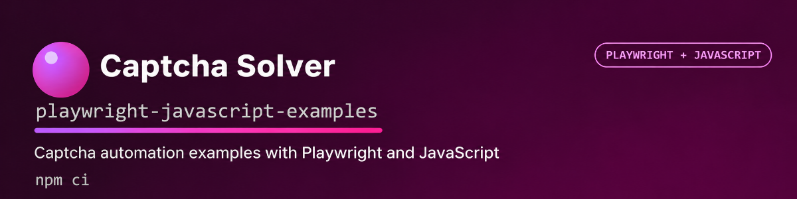

# Captcha Solver Playwright JavaScript Examples



Playwright adaptations of the official Captcha Solver JavaScript examples. Browser examples open a configured target page, dynamically extract CAPTCHA parameters, solve through `@captcha-solver-api/javascript-sdk`, and close the browser after completion.

Use the examples only on demo pages or websites you are authorized to test.

> [!IMPORTANT]
> Live examples create paid CAPTCHA tasks. Run them only with an API key you are authorized to use
> and against a target you own or have explicit permission to test.

## Install

```powershell
npm install
npx playwright install chromium
```

Create a local `.env` file from the committed template:

```sh
cp .env.example .env
```

On Windows PowerShell, use:

```powershell
Copy-Item .env.example .env
```

Open `.env`, set `CAPTCHA_API_KEY`, and review the configured target URLs before running an
example. The npm scripts load `.env` automatically. Keep this file private; it is ignored by Git.

The browser is visible by default. Set `HEADLESS=true` in `.env` to use headless mode.

## Run

```powershell
npm run recaptcha-v2
npm run recaptcha-v2-enterprise
npm run recaptcha-v3
npm run turnstile
npm run turnstile-challenge
npm run yandex
npm run yandex-image
npm run tencent
npm run geetest-v3
npm run geetest-v4
npm run image-to-text
npm run coordinates
npm run balance
```

Browser examples print `Solution:` when the SDK returns a result. Image examples print the
recognized text or click coordinates; the balance example prints the account balance. A solver
response alone does not prove that a page accepted the result.

After applying a solution, browser examples print `Page confirmation:` when their page-specific
check succeeds. Form examples read a success message; GeeTest examples check the demo verification
response. Turnstile Challenge checks the navigation HTTP status and a fresh clearance cookie.
Tencent checks that its captured callback received the same ticket and random string; this does
not prove server-side acceptance.

Each example logs errors through `console.error`. These handlers do not explicitly set a nonzero
exit code, so do not use the process exit code alone to determine whether solving succeeded.

## Examples

| Example                                                         | Target source      | Page acceptance |
| --------------------------------------------------------------- | ------------------ | --------------- |
| [reCAPTCHA v2](examples/recaptcha-v2.js)                        | `.env`             | Verified        |
| [reCAPTCHA v2 Enterprise](examples/recaptcha-v2-enterprise.js)  | `.env`             | Verified        |
| [reCAPTCHA v3](examples/recaptcha-v3.js)                        | `.env`             | Verified        |
| [Turnstile](examples/turnstile.js)                              | `.env`             | Verified        |
| [Turnstile Challenge](examples/turnstile-challenge.js)          | `.env`             | Verified        |
| [Yandex SmartCaptcha](examples/yandex-smartcaptcha.js)          | `.env`             | Verified        |
| [Tencent CAPTCHA](examples/tencent.js)                          | `.env`             | Callback only   |
| [GeeTest v3](examples/geetest-v3.js)                            | `.env`             | Verified        |
| [GeeTest v4](examples/geetest-v4.js)                            | `.env`             | Verified        |
| [Image to text](examples/image-to-text.js)                      | Local sample image | Not applicable  |
| [Coordinates](examples/coordinates.js)                          | Local sample image | Not applicable  |
| [Yandex image challenge](examples/yandex-smartcaptcha-image.js) | Local sample image | Not applicable  |
| [Balance](examples/balance.js)                                  | Solver API         | Not applicable  |

> [!IMPORTANT]
> A returned solution is not proof that a page accepted it. Examples marked “Verified” also submit
> the solution through the target page's form, callback, or verification endpoint and require an
> explicit successful response.

## Target pages

Browser target URLs are configured in the local `.env` file. The available names are listed in
`.env.example`, including
`RECAPTCHA_V2_TARGET_URL`, `RECAPTCHA_V3_TARGET_URL`, `RECAPTCHA_ENTERPRISE_TARGET_URL`,
`TURNSTILE_TARGET_URL`, `TURNSTILE_CHALLENGE_TARGET_URL`, `GEETEST_V3_TARGET_URL`,
`GEETEST_V4_TARGET_URL`, `YANDEX_TARGET_URL`, and `TENCENT_TARGET_URL`.

Before running an example, set its variable to a public demo or a page you own or are explicitly
authorized to test. This changes the target without editing source code.

For example, to test reCAPTCHA v3, open your local `.env` file and replace
`RECAPTCHA_V3_TARGET_URL` with the full URL of the page containing the CAPTCHA you want to test.
Save the file, then run `npm run recaptcha-v3`. Use the matching `*_TARGET_URL` variable and npm
command for other examples.

The `example.com/page_with_...` URLs in the template and examples are placeholders, not working
CAPTCHA demos. Replace them with your target page URL before running. For Tencent, also set
`TENCENT_SCRIPT_URL` to the CAPTCHA script URL used by that page.

> [!IMPORTANT]
> Overriding a URL does not automatically adapt selectors or verification logic. Review parameter
> extraction, injection, and the target's success state before using an example on another page.

Do not automate CAPTCHA solving on third-party websites without permission. When adapting an example, verify that its selectors and parameter extraction still match your target page.

Image and coordinate examples use sample files from `assets/`.

## Quality checks

Install Chromium with `npx playwright install chromium` before running the checks.
The browser regression tests intercept every request and use simulated pages and responses;
they do not visit external demo sites or create paid solver tasks.

These regression tests exercise the utilities in `test/`. They do not run the standalone examples
end to end. Syntax, lint, and formatting checks cover the example source files; confirming a live
example requires a separate authorized run.

```powershell
npm test
npm run lint
npm run format:check
```

Run all local checks together:

```powershell
npm run check
```

After the repository is published on GitHub, local quality checks run automatically on pushes and
pull requests with Node.js 22 and 24.

## Security

Report security issues privately as described in [SECURITY.md](SECURITY.md). Never include API
keys, cookies, credentials, or data from an unauthorized target in an issue or report.

## Troubleshooting

If Playwright reports that Chromium is missing:

```powershell
npx playwright install chromium
```

`UND_ERR_CONNECT_TIMEOUT` or `fetch failed` indicates that the solver API could not be reached. Persistent failures usually mean the API host is blocked or unavailable on the current network.

Browser examples close Chromium in `finally()` after their Promise chain completes or an error is
handled. Press `Ctrl+C` to interrupt a run; forced interruption can bypass this cleanup.

To format the source after editing:

```powershell
npm run format
```

## License

This project is licensed under the [MIT License](LICENSE.md).
